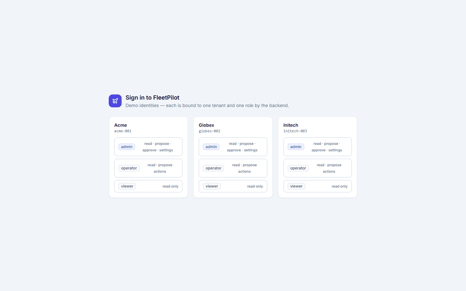
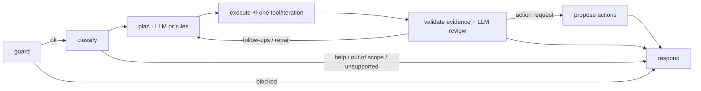

# FleetPilot — Agentic AI Fleet Operations Copilot

FleetPilot lets IT administrators **ask** questions about their device fleet in natural language, surfaces
**insights** from 30 days of telemetry, and **proposes actions** (upgrade orders, remediation tickets,
replacement flags, employee notifications) that execute only after an authorised human approves them.

* **Grounded:** every number comes from deterministic SQL/pandas tools; every answer carries structured,
  DB-validated evidence you can inspect down to the stored snapshot.
* **Agentic:** a LangGraph workflow — guard → intent → plan → bounded tool loop → evidence validation (+ result
  review and bounded re-planning) → action proposal → response — with an observable execution timeline.
* **LLM-driven when configured, deterministic when not:** with Anthropic or OpenAI the model interprets requests,
  plans read tools and arguments, inspects results to request dependent follow-up steps, resolves multi-turn
  references and phrases answers — every output validated, every stage with a deterministic fallback, and the
  active mode (deterministic / LLM-powered / hybrid / fallback) always shown.
* **Safe:** tenant isolation at query, schema and (PostgreSQL) row-level-security level, role permissions, server-gathered evidence for
  actions, payload-hash-bound and idempotent approvals, hash-chained append-only audit log, prompt-injection
  sanitising.
* **Evaluated, two suites reported separately:** 65 deterministic cases (**65/65**) and 43 LLM cases run with a
  mocked provider through the real SDKs (**43/43**) and a live-model subset on `claude-opus-5-5` (**12/12**), plus
  109 unit/integration tests (105 + 4 PostgreSQL-only), on SQLite and PostgreSQL 16.

Built for the Rayda *Senior Agentic AI Engineer* take-home.

---

## Screenshots & demo



The tour above covers every section of the app. The full walkthrough video
([`fleetpilot-walkthrough.webm`](docs/demo/fleetpilot-walkthrough.webm)) and individual screenshots of each
page are in the [`docs/demo/`](docs/demo) folder.

---

## Quick start

### Option A — Docker Compose (PostgreSQL + API + UI)

```bash
cp .env.example .env          # optional: set FLEETPILOT_LLM_PROVIDER + API key
docker compose up --build
```

The backend container runs migrations and (idempotently) ingests `data/device-telemetry-dataset.ndjson` on
start. Open **http://localhost:3000** and pick a demo user. API docs: http://localhost:8000/docs.

### Option B — Local, no services (SQLite)

Requires Python 3.12+ and Node 20+.

```bash
pip install -r backend/requirements.txt
echo "FLEETPILOT_DATABASE_URL=sqlite:///./backend/fleetpilot_dev.db" > .env
python scripts/ingest_dataset.py                                     # migrate + ingest + demo users
uvicorn app.main:app --app-dir backend --port 8000                   # API
cd frontend && npm install && npm run dev                            # UI on :3000 (proxies /api to :8000)
```

To use PostgreSQL locally instead: `docker compose up db`, keep the default `FLEETPILOT_DATABASE_URL` from
`.env.example`, then run the same commands.

### Demo users

Nine seeded identities — `{acme,globex,initech}-{admin,operator,viewer}` — selectable on the login page and
from the header. The tenant is bound to the user server-side.

| Role | Can |
|---|---|
| viewer | read telemetry, ask questions |
| operator | + propose actions |
| admin | + approve/reject actions, edit risk settings |

### Configuration

All configuration is environment-based (`FLEETPILOT_*`, see [`.env.example`](.env.example)). The LLM is
**optional** and secrets stay server-side:

| Mode | Configuration | LLM does |
|---|---|---|
| Deterministic (default) | `FLEETPILOT_LLM_PROVIDER=deterministic` | nothing — rules plan and answer |
| LLM-powered | `FLEETPILOT_LLM_PROVIDER=anthropic` (default model `claude-opus-5-5`) or `openai` (`gpt-4o-mini`) + `ANTHROPIC_API_KEY` / `OPENAI_API_KEY` | interpret, plan, review results (follow-ups), phrase answers |
| Hybrid | as above + `FLEETPILOT_LLM_STAGES=plan` | interpret, plan, review; answers composed deterministically |
| Deterministic fallback | provider selected but key/SDK missing, or every LLM call failed | nothing — **reported** in the header badge, Settings, `/api/system/llm-status` and each run |

Telemetry queries, risk scoring, evidence validation, tenant isolation and approvals are deterministic in every
mode. Details: [docs/llm-integration.md](docs/llm-integration.md).

## Running tests and evaluations

```bash
cd backend && python -m pytest                      # 105 passed + 4 skipped (RLS tests need PostgreSQL), ~60 s
python scripts/run_evaluations.py                   # deterministic suite, 65 cases -> evaluation/results/latest.md
python scripts/run_llm_evaluations.py               # LLM suite, 43 cases, mocked provider -> evaluation/results/llm_latest.md
python scripts/run_llm_evaluations.py --live        # + the configured real provider (needs its API key)
python scripts/run_llm_evaluations.py --live --live-cases L01,L02,L05,L06,L09,L12,L15,L19,L32,L33,L35,L42   # live subset (cost control)
python scripts/run_evaluations.py --db postgresql+psycopg://...   # deterministic suite on PostgreSQL (dedicated DB)
FLEETPILOT_TEST_DATABASE_URL=postgresql+psycopg://... python -m pytest   # tests on PostgreSQL (109 passed)
```

| Suite | Latest |
|---|---|
| Deterministic evaluation | **65/65** — factual 14/14, grounding 6/6, temporal 8/8, safety 15/15, tool selection 14/14, failure 8/8 |
| LLM evaluation, mocked provider | **43/43** — tool selection 34/34, task completion, grounding, safety, reliability 43/43 each |
| LLM evaluation, live provider | **12/12** on `claude-opus-5-5` (live Anthropic API, representative subset across 9 categories; 26 LLM calls, ~137k tokens). All five dimensions 100% |

Both LLM runs are in `evaluation/results/llm_latest.md`. In the live run the model interpreted phrasings the rule
classifier cannot place, decomposed two-part questions, resolved a dependent step through result review (riskiest
device → its battery history) and a multi-turn reference ("its battery"); every model-written answer passed grounding
verification, and injection / cross-tenant / approval-bypass attempts were stopped. The OpenAI provider is covered by
the mocked suite (request shape, structured output, refusal and error handling) but was not run against the live API.

The mocked LLM suite runs FleetPilot's real provider code and the real Anthropic/OpenAI SDK clients over a scripted
HTTP transport: it verifies how FleetPilot handles model output (including malformed and malicious output, 429s,
timeouts, bad keys), not how good a real model is. See [docs/evaluation.md](docs/evaluation.md).

## What you can ask

* *Which devices at Acme are running low on disk space?* → 2 devices, with 30-day pattern
  (persistent / deteriorating) and evidence
* *Show me devices failing high-severity compliance checks.* → none (the only high-severity check, disk
  encryption, passes everywhere) — answered with query evidence, not invented
* *How many devices are running an OS older than macOS 15?* → per-tenant count with device list
* *Which devices have consistently high RAM utilization?* → persistent (≥ 50% of snapshots > 80%) vs spikes
* *Which employees have devices with battery service recommendations?*
* *What are the biggest fleet health risks this month?* → ranked insights + risk scores
* *Is screen lock compliance getting worse over time?* → pass→fail regressions with dates
* *Create upgrade orders for devices with low storage* → evidence-backed proposals awaiting approval
* *Order a RAM upgrade for 1LYSSFD074BB* → refused: no persistent RAM pressure in telemetry
* *Show me Globex devices* (as Acme) / *Approve all pending actions* → refused by guardrails
* With an LLM: *Which of our laptops are basically out of room?* (rules can't place it), *Find our riskiest device
  and show me its battery history* (dependent follow-up step), *What about its battery?* (multi-turn)

## Application

| Section | Purpose |
|---|---|
| **Overview** | Live fleet health: totals, risk classes, storage/memory/battery health, OS mix, compliance by check, 30-day trends, top risks, PDF report |
| **AI Copilot** | Conversation, suggested questions, tool-call chips, Evidence Explorer, proposals, link to execution timeline |
| **Devices** | Searchable inventory with health indicators; device page with history charts, compliance heat-strip, risk breakdown, evidence |
| **Insights** | Findings with severity, pattern type, explanation, devices, dates, evidence and one-click proposals; risk ranking |
| **Actions** | Approval Center: pending/executed/rejected/failed/expired, evidence, justification, payload hash, approve/reject, history, execution result |
| **Agent Activity** | Per run: execution mode, provider/model, intent (+ source), structured plan with arguments, every LLM call (stage, result, latency, tokens), fallbacks, evidence-validation checks, and the step timeline with tool arguments and result previews; plus the verifiable audit log |
| **Settings** | Agent execution mode (read-only status + warnings); per-tenant thresholds, weights, bands, OS policy, software watch-list (admin only, audited) |

## Architecture

```
frontend/ (Next.js 15, React 19, Tailwind, Recharts) ──/api proxy──▶ backend/ (FastAPI)
  backend/app/agents      LangGraph graph, nodes, planner, composer, LLM providers, prompts
  backend/app/tools       13 read tools + 4 action tools (typed, permissioned, tenant-scoped)
  backend/app/analytics   trend rules, per-domain analyzers, risk engine, insights (deterministic)
  backend/app/services    actions/approvals, audit chain, dashboard, PDF report, action adapters
  backend/app/repositories tenant-scoped telemetry queries
  backend/app/guardrails  input guard, prompt-injection sanitising
  backend/app/ingestion   validated idempotent NDJSON loader, demo users
  backend/app/evaluation  evaluation cases, runner, harness
  backend/migrations      Alembic (PostgreSQL trigger for append-only audit)
```



Details: [docs/architecture.md](docs/architecture.md).

## Tool catalog

Read: `get_fleet_overview`, `get_device_details`, `find_low_storage_devices`, `analyze_memory_usage`,
`analyze_battery_health`, `get_compliance_status`, `analyze_compliance_trends`, `get_os_distribution`,
`get_installed_software`, `generate_fleet_insights`, `get_device_history`, `get_risk_scores`,
`get_employee_devices`.
Actions (proposal only): `create_upgrade_order(device_id, component, spec)`,
`open_remediation_ticket(device_id, check_id, note)`, `flag_device_for_replacement(device_id, reason)`,
`notify_employee(employee_id, message)`.

Full argument schemas (generated from the registry): [docs/tool-catalog.md](docs/tool-catalog.md).

## Grounding strategy

Tools compute; the LLM (optional) only selects read tools and arguments, requests follow-up reads, and phrases. Evidence is structured
(`evidence_id, device_id, company_id, snapshot_id, collected_at, metric, observed_value, threshold, comparator,
temporal_scope, source`) and re-validated against the DB for the caller's tenant before any response. LLM
answers must pass a verifier (every ID/number must appear in tool output, citations must exist) or are
replaced by the deterministic answer. Missing data is "unknown", spikes are distinguished from persistent
problems, policy thresholds are labelled as policy. → [docs/grounding-strategy.md](docs/grounding-strategy.md)

## Guardrails

Tenant from signed token only; PostgreSQL row-level security for every authenticated request; cross-tenant IDs
indistinguishable from unknown; `company_id` arguments rejected;
role permissions checked in three layers; actions only *proposed*; server-side evidence rules; approval bound
to a payload hash, expiring, compare-and-swap (no double execution), rejected/expired never execute; append-only
hash-chained audit log; input guard (cross-tenant, approval bypass, injection); telemetry sanitised before
reaching an LLM; bounded loops, retries, timeouts, rate limit. → [docs/guardrails.md](docs/guardrails.md)

## Key design decisions

Deterministic-first agent that runs without an LLM; single LangGraph workflow (no multi-agent theatre);
persisted approval state machine instead of in-memory interrupts; no RAG/vector DB (structured data);
thresholds as per-tenant policy; simulated, clearly labelled action adapter. Full table with trade-offs:
[docs/design-decisions.md](docs/design-decisions.md). Risk methodology: [docs/risk-scoring.md](docs/risk-scoring.md).
Dataset findings and verified statistics: [docs/discovery.md](docs/discovery.md). LLM stages, modes, retries and
fallback: [docs/llm-integration.md](docs/llm-integration.md).
