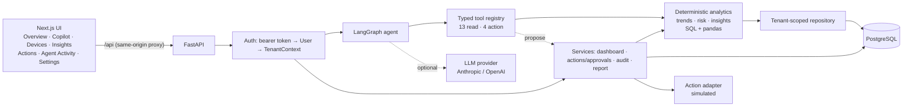
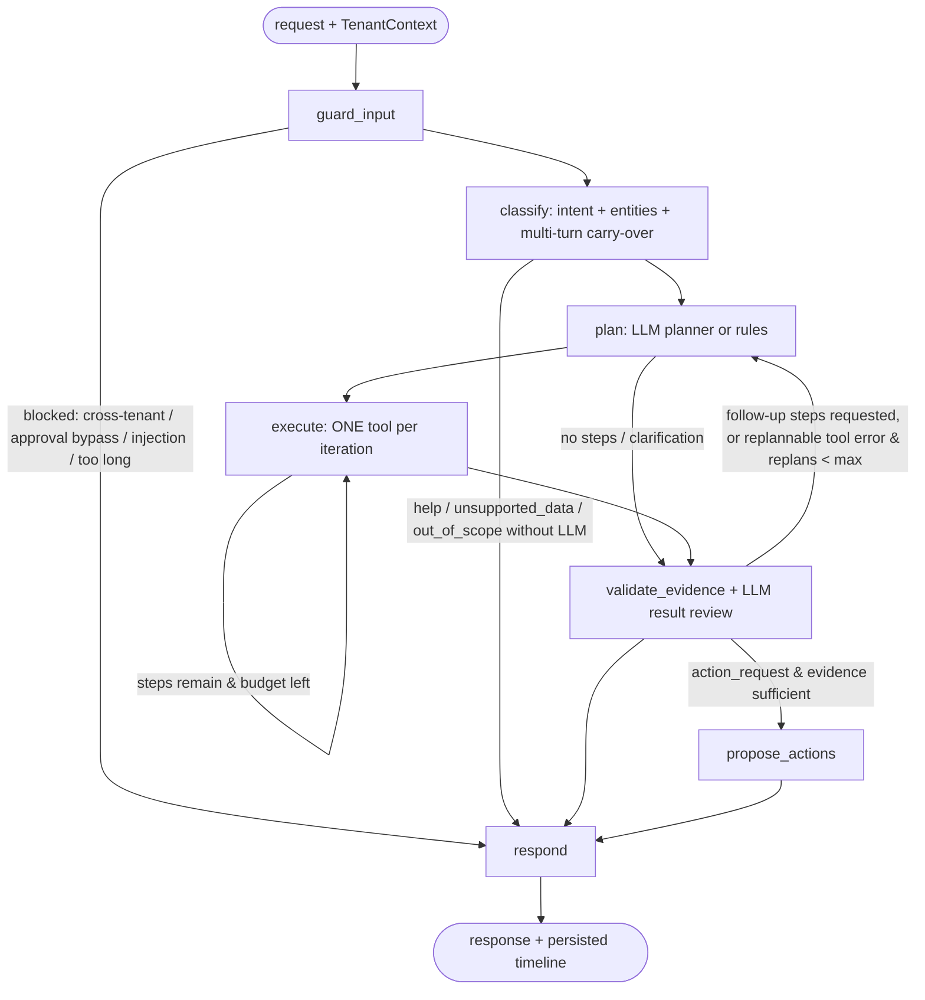

# Architecture

## System overview



Layering (each layer only calls the one below it):

| Layer | Package | Responsibility |
|---|---|---|
| API | `app/api/routes` | HTTP, auth dependency, rate limiting, error mapping |
| Agent | `app/agents` | LangGraph state machine, planning, composition, LLM abstraction |
| Tools | `app/tools` | Typed, permissioned, tenant-scoped capabilities with evidence output |
| Services | `app/services` | Action lifecycle, approvals, audit chain, dashboard, PDF report, adapters |
| Analytics | `app/analytics` | Pure deterministic computation: trend rules, analyzers, risk engine, insights |
| Repository | `app/repositories` | The only module that queries telemetry; every query filtered by `company_id` |
| Guardrails | `app/guardrails` | Input screening, prompt-injection sanitising |
| Ingestion | `app/ingestion` | Validated, idempotent NDJSON load + demo users |

Business logic never lives in prompts: prompts (`app/agents/prompts/*.md`) only describe the planner's and
composer's narrow jobs.

## Agent workflow (LangGraph)



| Node | What it does | Deterministic? |
|---|---|---|
| `guard_input` | Length limit, cross-tenant references (other companies' IDs/names), approval-bypass phrasing, prompt-injection patterns | yes |
| `classify` | Intent (`fleet_query`, `insight_request`, `device_lookup`, `action_request`, `help`, `out_of_scope`, `unsupported_data`) + entities (device/employee IDs, check, severity, thresholds, OS filter, software, action type, component). Follow-ups ("its battery", "those devices") inherit the previous answer's targets | yes |
| `plan` | LLM planner (structured JSON output, validated: unknown tools dropped, action tools dropped, tenant args stripped, args schema-checked; action hints fill gaps only; clarification when no reasonable plan) **or** rule planner. Any LLM failure → rule planner. On re-plan: appends LLM-requested follow-ups, or repairs failed steps — successful steps are never re-run | LLM optional |
| `execute` | Runs one step through `registry.execute` — permission, validation, retry, timing, tenant check on evidence. Loops via a conditional edge, bounded by `FLEETPILOT_AGENT_MAX_TOOL_CALLS` | yes |
| `validate_evidence` | Re-checks every evidence item against the DB for this tenant (company, snapshot existence, device existence); drops invalid items; decides `sufficient / partial / replan / not_found / insufficient`. With an LLM, a **result review** may then request up to 3 validated follow-up read steps (e.g. look up the device a ranking identified) → bounded re-plan | yes (+ LLM review) |
| `propose_actions` | Derives targets from explicit IDs or from validated tool results, calls action tools (which re-verify everything server-side). Max 10 proposals per request | yes |
| `respond` | Deterministic composer (grounded by construction). If an LLM is configured, it may rephrase, but the answer must pass `verify_grounding` (IDs, numbers, cited evidence) or it is discarded | LLM optional |

State (`app/agents/state.py`) holds only observable data: plan, cursor, tool results, evidence, validation,
proposals, timeline events and token usage. The runner (`app/agents/runner.py`) persists an `agent_runs` row
and one `agent_steps` row per timeline event — the source of the Agent Activity page.

LLM stages, execution modes, retries and fallback are described in [llm-integration.md](llm-integration.md).

**Why not a ReAct loop where the LLM freely calls tools?** The assessment values reliability and
reproducibility. Here the LLM's influence is confined to choosing among validated read tools and
phrasing; routing, evidence validation and action gating are code. The graph is still an explicit
agent loop with conditional routing and bounded re-planning.

## Approval mechanism

Approval is a **persisted DB state machine** rather than an in-memory LangGraph `interrupt()`:
proposals survive restarts, are reviewable by a different person at a different time, and can be
approved through the API without resuming a Python process. The agent run ends at
`approval_requested`; the Approval Center resumes the workflow (`approve → executing → executed|failed`).
See [guardrails.md](guardrails.md).

## Data model

```
companies 1─* employees 1─* devices 1─* device_snapshots 1─* disk_volumes
                                                       ├─* network_interfaces
                                                       ├─* installed_software
                                                       └─* compliance_results
companies 1─* users (IT admins; role viewer|operator|admin)
companies 1─* action_proposals 1─* action_approvals
companies 1─* audit_logs (hash-chained, append-only)
companies 1─* agent_runs 1─* agent_steps
companies 1─1 company_settings (risk policy)
ingestion_runs (stats per load)
```

* Snapshot PK = `sha1(device_id|collected_at)` → re-ingestion is idempotent; `UNIQUE(device_id, collected_at)`.
* Composite FKs `(device_id, company_id) → devices(id, company_id)` and `(employee_id, company_id) → employees`
  make cross-tenant references impossible at the database level.
* Primary-volume disk %, RAM %, battery fields are denormalised onto `device_snapshots` for fast fleet
  queries; full nested arrays are kept in child tables.
* Indexes: company+collected_at, device+collected_at, employee, compliance (company, check) and
  (device, check, collected_at), software name, audit (company, ts).
* `audit_logs` has an UPDATE/DELETE-blocking trigger in PostgreSQL (migration `0001`) plus an ORM guard.
* PostgreSQL row-level security (migration `0002`, `app/db/rls.py`): a `tenant_isolation` policy on every
  tenant-owned table; authenticated request transactions run as the unprivileged `fleetpilot_app` role with
  `fleetpilot.company_id` set transaction-locally. No-op on SQLite.
